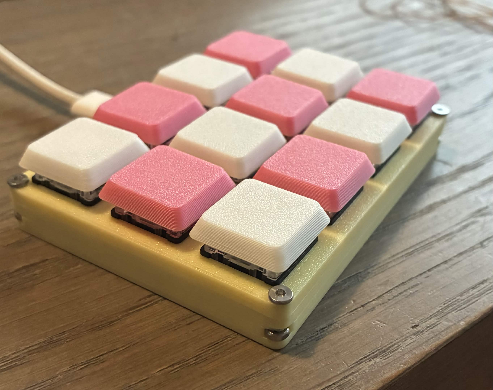
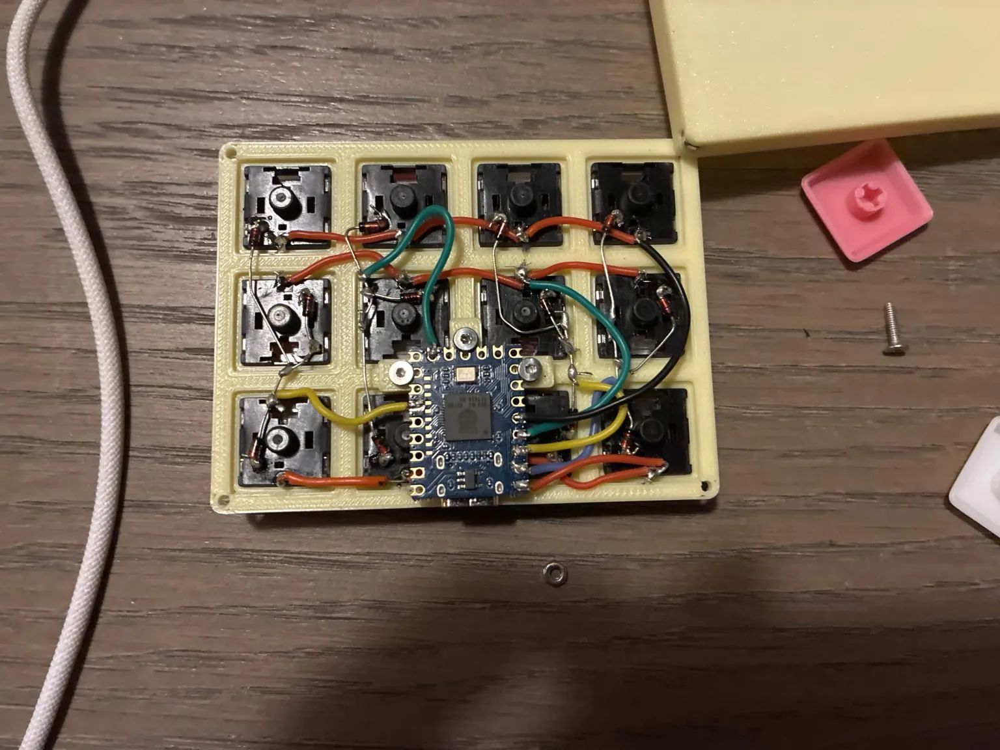

# This guide is for the tiny 4x3 keys macropad (cuty pad)

## Info
This macropad runs vial-qmk and has nkrl

source code for the macropad is available [HERE](https://github.com/backAir/Bair-s-vial-keyboards/tree/main/cuty_pad_4x3)
Parametric CAD for the case on [ONSHAPE](https://cad.onshape.com/documents/0b492086b265dca8838a7391/w/96bef00abaaaca43687c5202/e/2352dc67a37d36e38e0d4252?renderMode=0&rightPanel=variableTablePanel&uiState=6aea2a2f8dde105fd179c739) 

My discord: back_air

keys can be reprogrammed using [vial.rocks](https://vial.rocks/)

# What to buy ? 
Those are aliexpress links but ofc you can just buy it somewhere else:

100 diodes : [IN4148 through hole diodes](https://aliexpress.com/item/32660088529.html) 

RP2040-Zero (VERY IMPORTANT: The version where the pins aren't soldered yet) : [RP2040-Zero](https://aliexpress.com/item/1005006031224378.html)

4x 8mm flat head M2 screws
3x 5mm flat head M2 screws
7x M2 nuts (the hexagon shaped ones)
[screws & nuts](https://aliexpress.com/item/1005006419301367.html)

Redragon low profile switches [link](https://nl.aliexpress.com/item/1005005895710498.html)

## Guide
download the stl for the case and plate

handwire the matrix with one consideration: the diode's black line needs to be towards the columns 

make sure to flash the RP2040 before soldering it since it'll be hard to access later (to flash it just hold the boot button while plugging it in and then drag in the .uf2 file)

RP2040 wiring: 

Colums (from left to right when the keyboard is facing up with the usb port up): GP27, GP13 , GP2, GP1

Rows (from up to down): GP0,GP3,GP4

Before screwing in the screws insert an M2 nut in the slot that goes under it's hole

enjoy!
